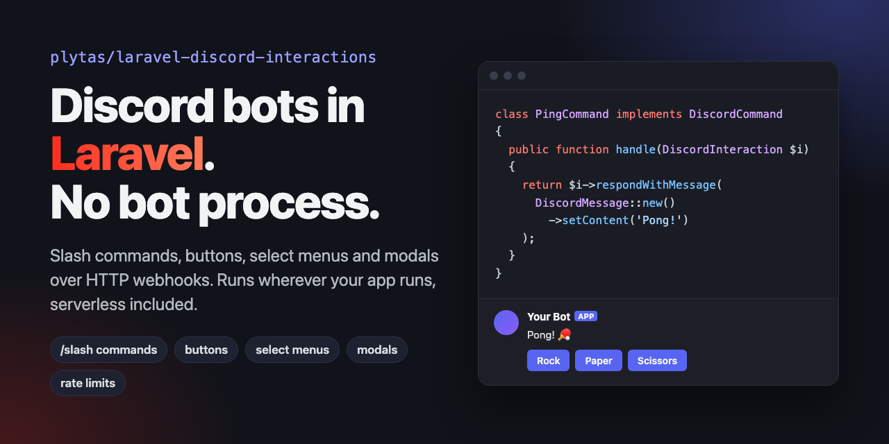

# Laravel Discord Interactions



**Build Discord bots in Laravel with slash commands, buttons, select menus and modals. Discord sends each interaction to an ordinary Laravel route, so there is no gateway connection and no bot process to keep running.**

[](https://packagist.org/packages/plytas/laravel-discord-interactions)
[](https://github.com/plytas/laravel-discord-interactions/actions?query=workflow%3Arun-tests+branch%3Amain)
[](https://github.com/plytas/laravel-discord-interactions/actions?query=workflow%3A"Fix+PHP+code+style+issues"+branch%3Amain)
[](https://packagist.org/packages/plytas/laravel-discord-interactions)

## Quick example

```php
use Plytas\Discord\Contracts\DiscordCommand;
use Plytas\Discord\Data\DiscordInteraction;
use Plytas\Discord\Data\DiscordMessage;
use Plytas\Discord\Data\DiscordResponse;
use Plytas\Discord\DiscordCommandRegistry;

class PingCommand implements DiscordCommand
{
    public function description(): string
    {
        return 'Replies with pong';
    }

    public function handle(DiscordInteraction $interaction): DiscordResponse
    {
        return $interaction->respondWithMessage(DiscordMessage::new()->setContent('Pong!'));
    }
}

// In a service provider's boot() method
DiscordCommandRegistry::setCommands(['ping' => PingCommand::class]);
```

Run `php artisan discord:register-commands`, and `/ping` is available in your Discord server.

## Why this package?

Most PHP Discord libraries, such as [DiscordPHP](https://github.com/discord-php/DiscordPHP) and [Laracord](https://github.com/laracord/framework), connect to the Discord gateway over a WebSocket. That needs a process that runs all the time and that you must supervise.

This package uses [Discord's HTTP interactions](https://discord.com/developers/docs/interactions/overview#preparing-for-interactions) instead. Discord sends a signed `POST` request to your app for each slash command, button click, select menu choice or modal submit. Your app responds like it does to any other HTTP request.

- **No worker to keep alive.** The bot runs wherever your Laravel app runs: shared hosting, Laravel Forge, Laravel Cloud, Laravel Vapor or other serverless platforms.
- **It scales like your web app.** Each interaction is one HTTP request.
- **It is plain Laravel.** Commands and component handlers are small PHP classes, and the interactions endpoint is a normal route with your own middleware.

Use a gateway library if your bot must react to events that are not interactions, such as new messages or members who join a server.

## Features

- Slash commands, with nested subcommands and command options
- Message components: buttons, string select menus and action rows
- Modals with text inputs
- Messages with embeds, files, replies and ephemeral (private) responses
- Deferred work: respond in less than 3 seconds, then update the message later
- Discord REST API client with request pooling and automatic rate limit handling
- Request signature verification for the interactions endpoint

## Installation

You can install the package via composer:

```bash
composer require plytas/laravel-discord-interactions
```

You can publish the config file with:

```bash
php artisan vendor:publish --tag="discord-interactions-config"
```

This is the contents of the published config file:

```php
return [
    'application_id' => env('DISCORD_APPLICATION_ID'),
    'public_key' => env('DISCORD_PUBLIC_KEY'),
    'bot_token' => env('DISCORD_BOT_TOKEN'),

    'rate_limit' => [
        'enabled' => (bool) env('DISCORD_RATE_LIMIT_ENABLED', true),
        'cache_store' => env('DISCORD_RATE_LIMIT_CACHE_STORE'),
        'max_wait' => (float) env('DISCORD_RATE_LIMIT_MAX_WAIT', 2),
    ],

    'pool_concurrency' => (int) env('DISCORD_POOL_CONCURRENCY', 5),

    'route' => [
        'path' => env('DISCORD_ROUTE', '/discord'),

        'middleware' => [
            'before' => [
                //ThrottleRequests::class,
            ],
            'after' => [

            ],
        ],
    ],
];
```

### Configuration

Create a new discord application at https://discord.com/developers/applications.
Copy the application id and public key from "General information" tab and bot token from "Bot" tab to your `.env` file.

### Interactions endpoint setup

For local development you can use services such as [expose](https://expose.dev) or [ngrok](https://ngrok.com/) to expose your local server to the internet.

In your discord application fill in `Interactions Endpoint URL` under "General information" with the url of your server followed by the path you set in the config file. By default it is `/discord`.

```
https://your-server-url.com/discord
```

When clicking the "Save Changes" button, Discord will send a couple `POST` request to the provided URL to verify the endpoint. One of them will intentionally contain an invalid signature. The package will automatically respond to these requests appropriately.

If the changes are saved successfully, you are good to go!

## Usage

### Creating a command

To create a new chat command, create a new class that implements the `Plytas\Discord\Contracts\DiscordCommand` interface.

```php
use Plytas\Discord\Contracts\DiscordCommand;
use Plytas\Discord\Data\DiscordInteraction;
use Plytas\Discord\Data\DiscordMessage;
use Plytas\Discord\Data\DiscordResponse;

class PingCommand implements DiscordCommand
{
    public function description(): string
    {
        return 'Replies with pong';
    }

    public function handle(DiscordInteraction $interaction): DiscordResponse
    {
        return $interaction->respondWithMessage(
            DiscordMessage::new()
                ->setContent('Pong!')
                ->ephemeral()
        );
    }
}
```

### Registering a command

You can register commands using `Plytas\Discord\DiscordCommandRegistry::setCommands` method. This can be done in the `boot()` method of a service provider.

```php
use Plytas\Discord\DiscordCommandRegistry;

DiscordCommandRegistry::setCommands([
    'ping' => PingCommand::class,
    
    // Nested commands
    'user' => [
        'role' => [
            'add' => AddRoleCommand::class,
            'remove' => RemoveRoleCommand::class,
        ],
    ],
]);
```

And finally call `php artisan discord:register-commands` to register the commands with Discord. It's recommended to run this command in a deployment script.

### Responding to interactions

Your commands will receive a `DiscordInteraction` object that contains information about the interaction. You can respond to the interaction directly by returning a `DiscordResponse` object.
`DidcordInteraction` object contains helper methods to create responses such as `respondWithMessage()`, `updateMessage()` and `showModal()`.

You must respond to interactions within **3** seconds. If you fail to do so, Discord will show a generic error message to the user. If you need more time to process the interaction, it is recommended to respond with a message that indicates that the command is still processing.
After processing is done, you can use `\Plytas\Discord\Facades\Discord::updateInteractionMessage()` in a `\Illuminate\Support\Facades\App::terminating()` callback to update the message.

```php
use Illuminate\Support\Facades\App;
use Plytas\Discord\Contracts\DiscordCommand;
use Plytas\Discord\Data\DiscordInteraction;
use Plytas\Discord\Data\DiscordMessage;
use Plytas\Discord\Data\DiscordResponse;
use Plytas\Discord\Facades\Discord;

class PingCommand implements DiscordCommand
{
    public function description(): string
    {
        return 'Replies with pong';
    }

    public function handle(DiscordInteraction $interaction): DiscordResponse
    {
        // Register a terminating callback to update the message after processing is done
        App::terminating(function () use ($interaction) {
            // Simulate a long-running process
            sleep(5);
        
            Discord::updateInteractionMessage(
                interaction: $interaction,
                message: DiscordMessage::new()
                    ->setContent('Pong!')
                    ->ephemeral()
            );
        });
    
        // Respond with a message that indicates that the command is still processing
        return $interaction->respondWithMessage(
            DiscordMessage::new()
                ->setContent('Calculating...')
                ->ephemeral() // Only the user who invoked the command can see the message
        );
    }
}
```

### Responding to component interactions

You can add components to your messages to allow users to interact with them.

```php
use Plytas\Discord\Components\ActionRow;
use Plytas\Discord\Components\Button;
use Plytas\Discord\Contracts\DiscordCommand;
use Plytas\Discord\Data\DiscordInteraction;
use Plytas\Discord\Data\DiscordMessage;
use Plytas\Discord\Data\DiscordResponse;
use Plytas\Discord\Enums\ButtonStyle;

class RockPaperScissorsCommand implements DiscordCommand
{
    public function description(): string
    {
        return 'Play rock-paper-scissors';
    }

    public function handle(DiscordInteraction $interaction): DiscordResponse
    {
        return $interaction->respondWithMessage(
            DiscordMessage::new()
                ->setContent('Select your move')
                ->addComponent(
                    component: ActionRow::new()
                        ->addComponent(
                            component: Button::new()
                                ->setCustomId('rock')
                                ->setLabel('Rock')
                                ->setEmoji('🪨')
                                ->setStyle(ButtonStyle::Primary)
                        )
                        ->addComponent(
                            component: Button::new()
                                ->setCustomId('paper')
                                ->setLabel('Paper')
                                ->setEmoji('📄')
                                ->setStyle(ButtonStyle::Primary)
                        )
                        ->addComponent(
                            component: Button::new()
                                ->setCustomId('scissors')
                                ->setLabel('Scissors')
                                ->setEmoji('✂️')
                                ->setStyle(ButtonStyle::Primary)
                        )
                )
                ->ephemeral() // Only the user who invoked the command can see the message
        );
    }
}
```

You can respond to component interactions by creating a new class that implements the `\Plytas\Discord\Contracts\DiscordComponentHandler` interface.

```php
use Illuminate\Support\Arr;
use Plytas\Discord\Contracts\DiscordComponentHandler;
use Plytas\Discord\Data\DiscordInteraction;
use Plytas\Discord\Data\DiscordMessage;
use Plytas\Discord\Data\DiscordResponse;

class RockPaperScissorsComponentHandler implements DiscordComponentHandler
{
    public function handle(DiscordInteraction $interaction): DiscordResponse
    {
        $playerSelection = $interaction->getMessageComponent()->custom_id;
        $botSelection = Arr::random(['rock', 'paper', 'scissors']);
        
        if ($playerSelection === $botSelection) {
            $message = 'It\'s a tie!';
        }
        
        $winningMoves = [
            'rock' => 'scissors',
            'paper' => 'rock',
            'scissors' => 'paper',
        ];
        
        if ($winningMoves[$playerSelection] === $botSelection) {
            $message = 'You win!';
        } else {
            $message = 'You lose!';
        }
        
        return $interaction->updateMessage(
            DiscordMessage::new()
                ->setContent($message)
                ->ephemeral()
        );
    }
}
```

### Registering component handlers

You can register component handlers using `Plytas\Discord\DiscordComponentRegistry::setComponentHandlers()` method. This method accepts an array of `component_id => DiscordComponentHandler class`. This can be done in the `boot()` method of a service provider.

```php
use Plytas\Discord\DiscordComponentRegistry;

DiscordComponentRegistry::setComponentHandlers([
    'rock' => RockPaperScissorsComponentHandler::class,
    'paper' => RockPaperScissorsComponentHandler::class,
    'scissors' => RockPaperScissorsComponentHandler::class,
]);
```

If you need more control over the component handler registration process, you can use `Plytas\Discord\DiscordComponentRegistry::handleComponentsUsing()` method.
This method accepts a closure that receives `Plytas\Discord\Data\DiscordInteraction` object and expects a `Plytas\Discord\Data\DiscordResponse` object to be returned.

Imagine that your components have a dynamic custom id that contains the name of the game. You can use the following code to handle the components:

```php
use Illuminate\Support\Str;
use Plytas\Discord\Data\DiscordInteraction;
use Plytas\Discord\Events\ComponentHandlerRegistered;

DiscordComponentRegistry::handleComponentsUsing(function(DiscordInteraction $interaction)  {
    $gameName = Str::afterLast($interaction->getMessageComponent()->custom_id, ':');
    
    return match ($gameName) {
        'rock-paper-scissors' => (new RockPaperScissorsComponentHandler)->handle($interaction),
        'coin-flip' => (new CoinFlipComponentHandler)->handle($interaction),
        'default' => $interaction->updateMessage(
            DiscordMessage::new()
                ->setContent('Invalid game')
                ->ephemeral()
        );
    };
});
```

### Sending requests at the same time

`Discord::pool()` sends read requests at the same time and returns the same results as the methods with the same names. The keys of the returned array are the keys of the array that the callback returns.

```php
use Plytas\Discord\DiscordPool;
use Plytas\Discord\Facades\Discord;

[$channels, $roles] = Discord::pool(fn (DiscordPool $pool) => [
    $pool->getChannels($guildId),
    $pool->getRoles($guildId),
]);
```

The pool sends `pool_concurrency` requests at the same time (5 by default). Pass a second argument to change it for one call. A failed request throws, the same as the method with the same name.

### Rate limits

The package follows the [Discord rate limits](https://discord.com/developers/docs/topics/rate-limits) for every request, pooled or not.

- Discord tells in each response which rate limit bucket the route uses, how many requests the bucket has left, and when it resets. The package keeps this in the cache and takes one request from the bucket before it sends the next request on the same route.
- When the bucket or the global limit is empty, the request waits until the reset. When the wait is longer than `rate_limit.max_wait` seconds (2 by default), the request is not sent and `Plytas\Discord\Exceptions\DiscordRateLimitedException` is thrown. Its `retryAfter` property tells how many seconds to wait. A queued job can use it to release itself back to the queue.
- A `429` response is retried once when its `retry_after` is not longer than `rate_limit.max_wait`.

Set `rate_limit.cache_store` to a cache store that all your workers share, for example `redis` or `database`. With a store that each process keeps for itself, such as `array`, each worker knows only its own requests.

Set `rate_limit.enabled` to `false` when your app handles the Discord rate limits itself. The package then sends every request at once and does not retry `429` responses.

> [!WARNING]
> Not all components and API features are supported yet. This package started as a personal project and is still in development. If you need a specific feature, feel free to open an issue or a pull request.

## Testing

```bash
composer test
```

## Changelog

Please see [CHANGELOG](CHANGELOG.md) for more information on what has changed recently.

## Contributing

Please see [CONTRIBUTING](CONTRIBUTING.md) for details.

## Security Vulnerabilities

Please review [our security policy](../../security/policy) on how to report security vulnerabilities.

## Credits

- [Plytas](https://github.com/Plytas)
- [All Contributors](../../contributors)

## License

The MIT License (MIT). Please see [License File](LICENSE.md) for more information.
